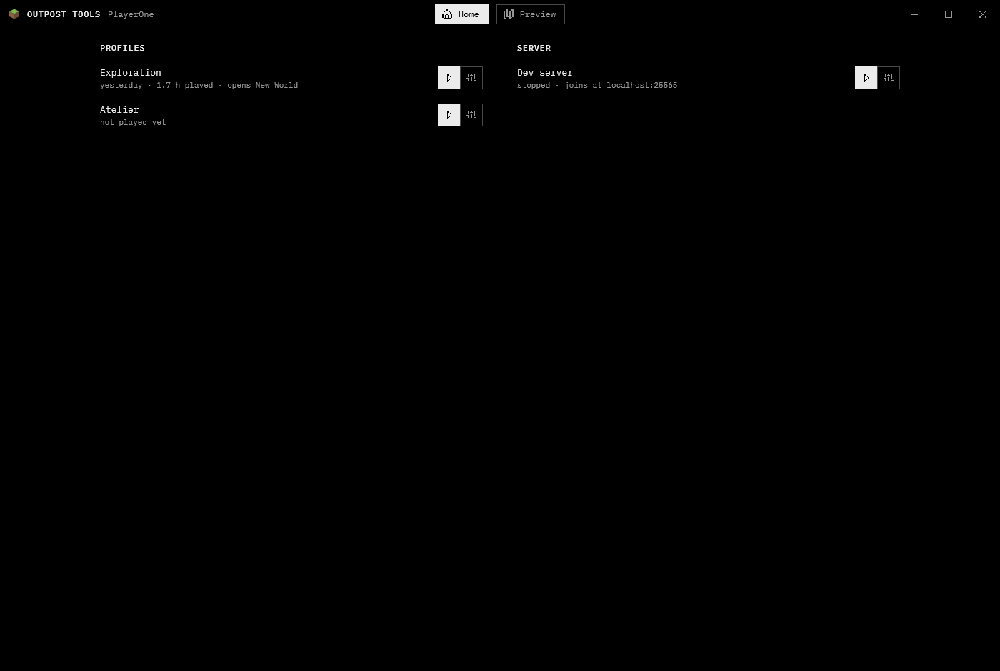
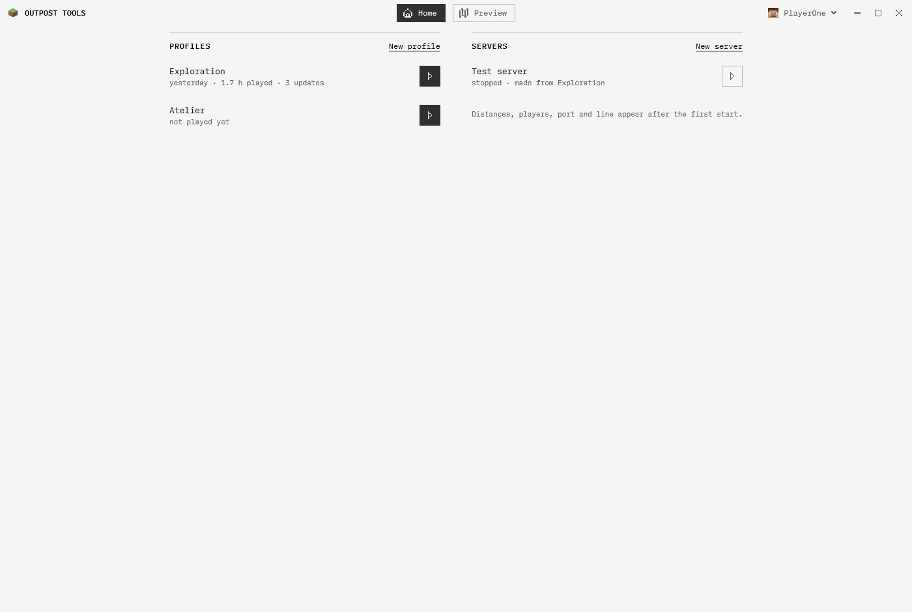

# Outpost Tools

<!-- PLACEHOLDER: the opening picture, taken in the game by the maintainer. A pillager outpost, with the world
     stretching far behind it. Replace this block with:
      -->
> **[Picture to come]** A pillager outpost in the game, with the world stretching far behind it.

Outpost Tools is one Windows application that holds Minecraft Java Edition tools in one window:

- a **launcher**: your profiles, each with its Play button, and the time you last played;
- the **world preview**: a map of a world drawn before anyone explores it, from the game's own generator;
- a **test server**: a local server started and stopped with one click.

A bar at the top switches between them, and closing the window stops everything. It ships with no modpack: you add the packs you play.

> **Work in progress.** Today Outpost Tools runs on its maintainer's machine, built from source, next to the modpack it was made for. It is not yet something you can download and run. [Not built yet](#not-built-yet) lists what is missing.

## Screenshots

| | Dark | Light |
| --- | --- | --- |
| Home |  |  |
| World preview |  |  |

The pictures come from the native launcher's own tests (`cargo test` in `native/`), drawn offscreen from a fake set of profiles. The window follows Windows' light or dark setting.

## How it works

- It is native Rust, drawn with [mere-ui](#what-it-needs-today), its maintainer's interface toolkit (Direct2D, no web view). The world preview's window lives here (`preview/`), and its maps come from the `world-preview` repository's engine, which the native launcher calls as a Rust library (`world_preview::run`), in its own process.
- The game starts through [Prism Launcher](https://prismlauncher.org/), which keeps the Microsoft sign-in. Outpost Tools only gives Prism commands: you never open Prism to play.
- Each profile is a Prism instance. Its settings (memory, Java arguments, what it opens on: the menu, a world or a server) are written straight into Prism's own files, so the two never disagree.
- An older form of the launcher, a web page in a frameless window of its own (`app/` and `index.html`), still exists. Both forms share one api (`app/src/api/`) and never run together.

## What it needs today

The native launcher builds from a clone of this repository alone: cargo fetches mere-ui and the `world-preview` engine from GitHub, each pinned by a tag in the `Cargo.toml` files.

To build and run Outpost Tools you need:

- Windows, PowerShell 7 and Rust (`rustup`, stable);
- the `world-preview` repository beside the pack or at `WORLD_PREVIEW_DIR`, for the preview tool: the launcher builds its mod at run time from that checkout;
- Prism Launcher, installed with Scoop;
- a **pack repository**, given to the program with `--repo <folder>`. That is where it reads what it drives today: `scripts/common.ps1` (the server and preview folders, and where Prism is), `scripts/dev-server.ps1` and `scripts/rcon.ps1` (the test server), and `pack/` (the modpack the world preview reads).

That last point is the main gap. Profiles and folders should be data in Outpost Tools' own folder, not the scripts of one pack.

## Not built yet

What stands between today and the goal (download one exe, double-click, play):

- **The self-installing exe.** It would put itself in its own folder, add its Start menu shortcut and update itself from this repository's releases.
- **Portable Prism.** Prism Launcher would be downloaded in its portable form and kept up to date by Outpost Tools, so nobody installs it by hand.
- **Profiles as data.** Profiles would be added from a modpack file and kept in Outpost Tools' folder, instead of the paths a pack's scripts write.
- **The Rust port.** What runs in PowerShell today (the pack's sync, the test server) would move to Rust, as the preview's generation already has, so the PC needs nothing else.
- **Signing.** The exe is not signed: Windows warns once on the first download, and Smart App Control blocks it. Signing names the publisher, but the warning stays until the app has a reputation.

Also not built: the bar's cube is a placeholder icon.

## Building

```powershell
cd native; cargo build --release     # the native launcher: native\target\release\launcher-native.exe
cd native; cargo test                # its tests; the pictures land in native\target\tmp
cd app; cargo build --release        # the page launcher: app\target\release\launcher.exe
```

Run either with `--repo <pack repository>`. `outpost-tools --shot out.png --tool home|preview --theme dark|light` draws one frame offscreen from the fake api, with no window. The world preview's pictures, and the tests that draw them, read the world of a preview's out folder named by `--data` or the `PREVIEW_DATA_DIR` environment variable; without one they are skipped. `shots.ps1` takes pictures of the page launcher in a headless Brave or Edge.

`preview/` (the world preview's window) and `relief/` (its relief in 3D) build and test the same way, each in its own folder.

### Working on mere-ui at the same time

To try a change of mere-ui before it is tagged, point cargo at a local checkout in a `.cargo/config.toml` at the root of this repository, which git ignores:

```toml
[patch."https://github.com/louisfifre/mere-ui"]
mere-base = { path = "../mere-ui/crates/mere-base" }
mere-layout = { path = "../mere-ui/crates/mere-layout" }
mere-ui = { path = "../mere-ui/crates/mere-ui" }
mere-win32 = { path = "../mere-ui/crates/mere-win32" }
mere-png = { path = "../mere-ui/crates/mere-png" }
```

The paths are relative to this repository's root, or absolute. While the patch is there, cargo rewrites the `Cargo.lock` of each crate you build to the local copy: **do not commit a `Cargo.lock` changed by the patch**. Remove the file, then `git checkout -- <crate>/Cargo.lock`, before committing.

## What is where

| Path | What it holds |
| --- | --- |
| `native/` | The native launcher, the default one: the world preview's window with the launcher's Home, calling `app`'s api as a library. |
| `preview/` | The world preview's window, drawn with mere-ui, over the `world-preview` engine; also a program of its own. |
| `relief/` | The world preview's relief in 3D, in a window or as a PNG, from a real out folder. |
| `app/` | The api every form shares (`src/api/`: profiles, test server, world preview, settings files), and the page launcher's program (tao and wry). |
| `index.html` | The page launcher's page, read from disk at each load. |
| `shots.ps1` | Pictures of the page launcher without a window. |
| `docs/shots/` | The pictures of this README. |
| `THIRD-PARTY.md` | Third-party work this repository carries (the icons). |

## Licence

Outpost Tools is under the [GNU General Public License v3.0](LICENSE). Third-party parts keep their own licences: see [THIRD-PARTY.md](THIRD-PARTY.md). Minecraft is a trademark of Mojang. Outpost Tools is not affiliated with Mojang or Microsoft.
